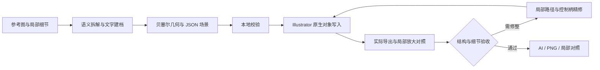

# Illustrator Native Rebuild

**Illustrator 原生矢量重建与精修**

从参考图的结构理解，到可编辑矢量作品的细节修整。

面向科研图示、技术示意图与复杂插画的助手工作流：通过语义拆解、贝塞尔曲线重构、原生对象建模与多尺度视觉复核，重建可持续编辑的 Adobe Illustrator 作品。交付覆盖路径、文字、渐变和层级组织，并将局部放大检查与迭代精修纳入完成标准。

## 核心能力

- **语义级结构重建**：按图形含义拆分对象，保留数量、比例、连接与遮挡关系，为每个元素建立可独立选择的命名编组。
- **贝塞尔曲线精修**：围绕关键端点、切线和轮廓转折设计锚点，修整压缩噪声、锯齿、尖刺及碎片边缘，保留真实孔洞与不规则形态。
- **多尺度视觉复核**：在使用尺寸与 200%–400% 局部放大下对照参考图，检查接缝、孔缘、交叠和箭头连接；修正后重新导出验证。
- **Illustrator 原生编辑**：建立 PathItem、CompoundPathItem、TextFrame、GradientColor 和 GroupItem，保留文字内容、曲线控制点、渐变色标与编组层级的编辑能力。
- **可追溯交付**：保存真实 `.ai` 文件、由目标文档实际导出的 PNG、关键局部对照，以及按需提供的 JSON 场景描述。

## 工作流程



视觉分析、场景设计和精修判断由宿主助手执行。附带脚本负责已知几何的校验和写入；不包含自动识图、自动曲线拟合或自动视觉验收算法。精修回写需按目标对象编写局部 JSX 操作，不能直接重复运行追加式写入命令。

### 默认精修要求

单独调用 skill 即包含去毛边和精修要求：先建立元素清单检查漏画，再区分像素噪声与真实轮廓，为曲线设计实际贝塞尔控制柄，完成原生文字、渐变和独立编组，最后逐项核对整体与 200%–400% 局部对照。发现缺失轮廓、碎片或接缝问题时需修正并重新导出。

写入器不会替轮廓点自动拟合曲线。只提供锚点会得到直线段，`smooth: true` 也不代替控制柄设计。默认要求是助手的执行与验收流程，不是新增的自动去噪算法；实际质量仍需通过参考图对照验证。

## 技术栈

| 层级 | 技术 | 作用 |
| --- | --- | --- |
| 任务编排 | SKILL.md、支持图像理解的宿主助手 | 参考图观察、语义拆解、文字建档及精修决策 |
| 场景建模 | JSON、三次贝塞尔曲线、控制柄与复合路径 | 表达几何、文字、样式、层级和坐标变换 |
| 校验与调度 | Node.js 18+、CommonJS、内置 fs/path/child_process | 检查场景字段、几何数据和输出路径，准备执行载荷 |
| 桌面桥接 | Windows PowerShell 5.1、COM Automation | 连接运行中的 Illustrator，通过 DoJavaScript 执行本地 JSX |
| 原生绘制 | Adobe ExtendScript（JSX）、Illustrator DOM | 创建路径、点文字、线性/径向渐变及嵌套编组 |
| 保存与导出 | IllustratorSaveOptions、ExportOptionsPNG24 | 保存 PDF 兼容 AI，导出画板范围的 200% PNG |
| 离线测试 | node:test、node:assert/strict、node:vm | 校验场景与模拟对象写入行为，无需打开 Illustrator |

核心脚本没有第三方 npm 依赖，不需要 Python。可选的本地裁切或轮廓提取工具不属于内置依赖。详细设计见 [架构说明](references/architecture.md)。

## 使用方式

### 获取与安装

仓库地址：[yu-design-lab/illustrator-native-rebuild](https://github.com/yu-design-lab/illustrator-native-rebuild)。

下载方式任选其一：

- 在仓库页面选择 **Code → Download ZIP**，解压后将目录命名为 `illustrator-native-rebuild`。
- 使用 Git 获取完整目录：

```powershell
git clone https://github.com/yu-design-lab/illustrator-native-rebuild.git
```

将本目录作为一个完整 skill 安装到宿主助手的 skills 目录，保留 `SKILL.md`、`agents`、`references` 和 `scripts` 的相对结构。调用示例：

> 使用 $illustrator-native-rebuild 保真重建这张参考图，保留原生文字、路径、渐变和语义编组；完成 200%–400% 局部放大对照和轮廓精修，交付 AI、PNG 与关键细节对照图。

桌面写入需要 Windows、已运行的 Adobe Illustrator、已打开且处于活动状态的目标文档，以及场景引用的字体。画板尺寸和插入位置由任务明确指定，脚本不会调整画板或自动避让已有对象。

在本目录运行：

```powershell
# 只读检查已打开文档
node scripts/native-rebuild.cjs --inspect --output-dir work

# 根据检查结果准备 scene.json，再校验本地场景
node scripts/native-rebuild.cjs --scene scene.json --output-dir work

# 将场景写入指定的活动文档并保存、导出
node scripts/native-rebuild.cjs --scene scene.json --output-dir work --apply
```

场景格式和完整示例见 [native-scene.md](references/native-scene.md)。执行前创建场景指定的输出目录；每次重建使用唯一图层名与未占用的预览路径。输出 AI 已存在时，仅允许保存到当前目标文档本身。

## 验收与交付

验收同时覆盖对象结构和最终视觉效果：检查文字可编辑性、原生渐变、编组关系及新增图层中的位图/置入对象；再逐一复核轮廓、孔洞、连接、颜色与文字位置。结构报告中的 `visualChecked: false` 表示仍需视觉检查。

| 交付物 | 内容 |
| --- | --- |
| `.ai` | 实际保存的原生 Illustrator 文档 |
| `.png` | 从该文档实际导出的整体预览 |
| 局部对照图 | 助手另行制作的参考图与重建图同区域放大对照 |
| `scene.json`（按需） | 可复现的对象与样式描述 |
| 精修说明 | 已修整部位、检查结果及剩余差异 |

## 当前能力边界

- Windows 提供桌面桥接；其他系统可校验与准备场景，尚不提供桌面写入。
- 原生写入器以追加新图层为主，不内置自动局部替换、断点续画或批量自动精修。已有作品的局部调整由助手编写范围明确的本地 JSX 完成。
- 支持线性/径向渐变；复杂裁剪、网格渐变、滤镜与混合模式需专项实现及验证。
- 随附脚本在本地执行、不上传参考图；宿主助手的运行方式由所用平台决定。
- 缺失字体、同名图层、目标文档不匹配或已有输出冲突会中止执行。发生部分写入时先检查报告和目标图层，再决定修复方式。

## 开发与验证

```powershell
node --test scripts/native-rebuild.test.cjs
```

测试覆盖场景校验、原生曲线与文字、渐变矩阵、复合路径、绘制层级和写入前检查。模拟测试不代替真实 Illustrator 中的视觉验收。扩展对象类型时应同步更新场景规范、校验器、JSX 写入器和测试。

```text
illustrator-native-rebuild/
├── SKILL.md
├── README.md
├── agents/openai.yaml
├── references/
│   ├── architecture.md
│   └── native-scene.md
└── scripts/
    ├── native-rebuild.cjs
    ├── native-runtime.jsx
    ├── bridge.ps1
    └── native-rebuild.test.cjs
```

## 许可证

本项目采用 [MIT License](LICENSE)，允许使用、修改、分发和商业使用，分发时需保留版权与许可声明。Adobe Illustrator、字体及宿主助手遵循各自的许可条款。
